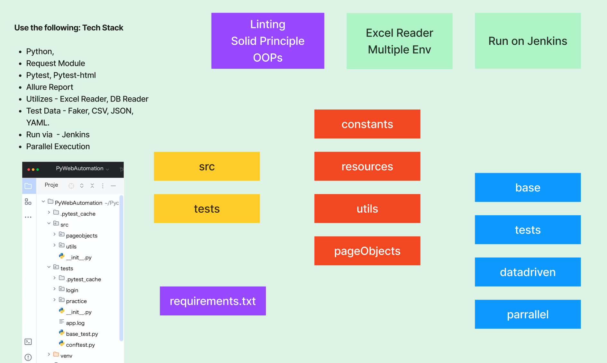
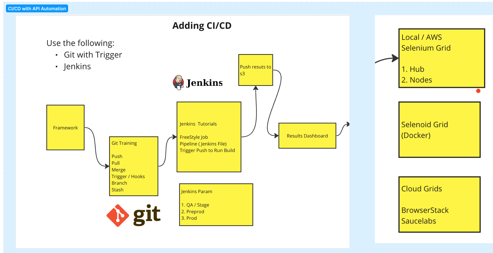

# 🚀 Python Web Automation Framework | Selenium + PyTest + Page Object Model

<p align="center">


</p>

---

# 📌 Project Overview

This repository demonstrates a **production-ready Selenium Automation Framework** developed using **Python & PyTest** following modern automation engineering practices.

The framework has been designed keeping **scalability, maintainability, reusability, parallel execution, reporting and CI/CD integration** in mind.

It follows industry-standard automation architecture used by product companies and enterprise QA teams.

---

# 🔗 Repository

**GitHub Repository**

https://github.com/ArpitChoubey/PythonWebAutomationFramework

---

# 👨‍💻 Author

**Arpit Choubey**

Automation Test Engineer | QA Automation | Python | Selenium | API Testing | SQL | CI/CD

---

# ⭐ Key Highlights

✔ Selenium WebDriver

✔ Python

✔ PyTest Framework

✔ Page Object Model (POM)

✔ Page Factory Design Pattern

✔ Parallel Execution using PyTest-xdist

✔ Allure Reporting

✔ HTML Reports

✔ Data Driven Testing

✔ MySQL Database Validation

✔ Environment Variable Support (.env)

✔ YAML Configuration

✔ Excel Data Reader

✔ Faker Test Data

✔ Explicit Wait Implementation

✔ Screenshot Capture

✔ Element Highlighting during Execution

✔ Modular Folder Structure

✔ Easy Maintenance

✔ Scalable Framework

---

# 🏗 Framework Architecture

The framework is developed following **Page Object Model (POM)** and **Page Factory** to keep test scripts clean and reusable.

Major components include:

- Test Layer
- Page Objects
- Utilities
- Constants
- Configuration
- Test Data
- Database Validation
- Reporting
- Parallel Execution

---

# 📂 Project Structure

```
PythonWebAutomationFramework
│
├── Test
│   ├── constants
│   ├── pageobjects
│   ├── pom
│   ├── utilitis
│   ├── vwo_loginTest
│
├── requirement.txt
├── pytest.ini
├── ReadMe.md
│
└── Reports
```

---

# 🖼 Framework Structure

> Repository Folder Structure



---

# 🚀 Framework Features

## ✔ Page Object Model

Separates UI locators from test scripts making maintenance easier.

---

## ✔ Page Factory

Uses Page Factory pattern for better object initialization and cleaner code.

---

## ✔ Parallel Execution

Supports multi-threaded execution using:

```
pytest-xdist
```

Run hundreds of tests simultaneously.

---

## ✔ Allure Reporting


Professional interactive reports with

- Test Steps
- Screenshots
- Failure Logs
- Execution Time
- History
- Categories

---

---

## ✔ HTML Reports

Generate execution reports using pytest-html.

---

## ✔ Data Driven Testing

Supports

- Excel
- CSV
- Faker Generated Data

---

## ✔ Database Validation

Framework validates UI data against MySQL database.

Useful for End-to-End Automation.

---

## ✔ Environment Variables

Supports

```
.env
```

for secure credential management.

---

## ✔ YAML Configuration

Externalized configuration for better maintainability.

---

## ✔ Screenshot Capture

Automatic screenshots on failure.

---

## ✔ Highlight Elements

Elements are highlighted while execution for better debugging.

---

## ✔ Reusable Utilities

Framework contains reusable utility classes for

- Excel Reader
- MySQL Reader
- Common Utilities
- Configuration Handling

---

# 📊 Technology Stack

| Technology | Usage |
|------------|-------|
| Python | Programming Language |
| Selenium | Web Automation |
| PyTest | Test Framework |
| Allure | Reporting |
| HTML Report | Reporting |
| MySQL | Database Validation |
| Faker | Test Data |
| YAML | Configuration |
| Dotenv | Environment Variables |
| Git | Version Control |
| GitHub | Repository |
| Page Factory | Design Pattern |
| Page Object Model | Framework Design |

---

# 📷 Allure Report

The framework generates professional Allure Reports with execution summary, logs, screenshots and failure analysis.

**Proof of Framework Execution**



---

# ⚙ Installation

Clone Repository

```bash
git clone https://github.com/ArpitChoubey/PythonWebAutomationFramework.git
```

Move inside project

```bash
cd PythonWebAutomationFramework
```

Install dependencies

```bash
pip install -r requirement.txt
```

---

# 📦 Required Packages

```bash
pip install allure-pytest selenium
pip install pytest selenium pytest-html openpyxl
pip install selenium-page-factory
pip install pyyaml faker openpyxl
pip install pytest-xdist
pip install mysql-connector-python
pip install pytest-reportportal
pip install python-dotenv
```

Or install everything together

```bash
pip install allure-pytest selenium pytest selenium-page-factory pytest-html openpyxl pyyaml faker pytest-xdist mysql-connector-python python-dotenv
```

---

# ▶ Running Tests

## Execute Complete Framework

```bash
pytest -n auto tests/test/vwoLoginTests/test_*
```

---

## Execute Single Test File

```bash
pytest tests/test/vwoLoginTests/test_vwo_login_pf.py
```

---

## Execute Parallel Tests

```bash
pytest -n auto tests/test/vwoLoginTests/test_vwo_login.py
```

---

## Generate Allure Report

```bash
pytest --alluredir=allure-results
```

Generate report

```bash
allure serve allure-results
```

---

# 🧪 Framework Capabilities

✔ Login Automation

✔ Page Validation

✔ UI Verification

✔ Database Verification

✔ Data Driven Testing

✔ Parallel Execution

✔ Reporting

✔ Screenshot Capture

✔ Cross Browser Ready

✔ Easily Extendable

---

# 🔥 Why This Framework?

This project demonstrates practical automation engineering skills expected from an Automation QA Engineer or SDET, including:

- Framework Design
- Selenium Best Practices
- Object-Oriented Programming
- Reusable Components
- Reporting
- CI/CD Readiness
- Database Testing
- Data-Driven Testing
- Parallel Execution
- Maintainable Automation Architecture

---

# 🎯 Suitable For

- QA Automation Engineers
- Software Development Engineers in Test (SDET)
- Test Automation Engineers
- QA Leads
- QA Managers
- Automation Architects
- Engineering Managers

---

# 📈 Future Enhancements

- Jenkins Integration
- GitHub Actions
- Docker Support
- Selenium Grid
- Cross Browser Execution
- BrowserStack Integration
- API + UI Hybrid Framework
- Performance Testing Integration

---

# 🤝 Contributions

Contributions, suggestions and improvements are always welcome.

Feel free to fork the repository and raise a Pull Request.

---

# ⭐ If you found this project useful

Please consider giving it a ⭐ on GitHub.

It motivates me to continue building enterprise-grade automation frameworks and sharing them with the QA community.

---

## 📬 Connect With Me

**Author:** Arpit Choubey

GitHub:
https://github.com/ArpitChoubey

Repository:
https://github.com/ArpitChoubey/PythonWebAutomationFramework

---

> *"Good test automation is not about writing more scripts—it's about building reliable, scalable, and maintainable engineering solutions."*

